# 🏫 Patrimônio Escolar — App Mobile (Flutter)

Sistema Integrado de Gestão de Patrimônio Escolar. Aplicativo mobile
oficial para gestão e acompanhamento dos patrimônios de uma instituição
de ensino, operando sobre a API REST em Go fornecida pela equipe.

**Repositório:** <https://github.com/Equipe-de-Dev-6/reserva-mobile>


> 📖 **Primeira vez no projeto?** Comece pelo **[guia do projeto](docs/GUIA.md)**:
> como o app funciona por dentro (caminho de uma requisição, camadas do
> MVC, guardas de rota, mapa "quero mudar X → vá em Y") e como rodar
> tudo (backend, app, testes, prints, protótipo).
>
> 🎤 **Na hora da arguição?** O **[roteiro de arguição](docs/ARGUICAO.md)** tem
> as 10 perguntas mais prováveis do professor, com a resposta, o arquivo
> exato onde a resposta está e o porquê de cada decisão — mais os
> números do projeto, as armadilhas conhecidas e um roteiro de
> demonstração de 5 minutos.

---

## 📸 Telas do aplicativo

As imagens abaixo são **prints reais do app**, gerados pelo próprio
código Flutter (não são mockups): cada tela é montada com as widgets de
produção, no tamanho do iPhone 13 (390 × 844) e com os payloads do
backend. O script que os gera está em `tool/gerar_prints_test.dart`.

| | |
|---|---|
| 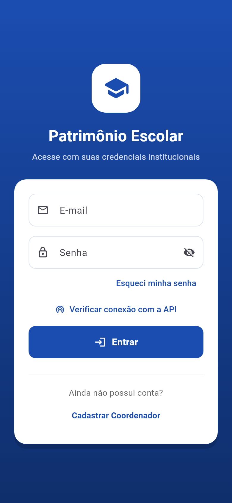 <br/> **Login** (RF01) | 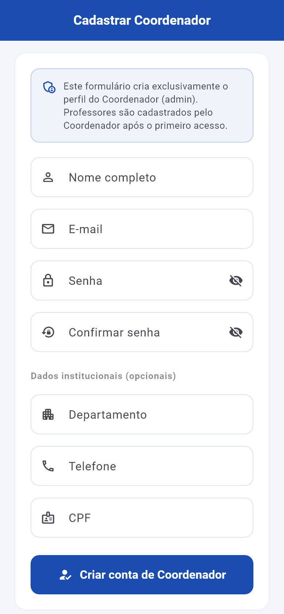 <br/> **Cadastro de Coordenador** (RF02) |
| 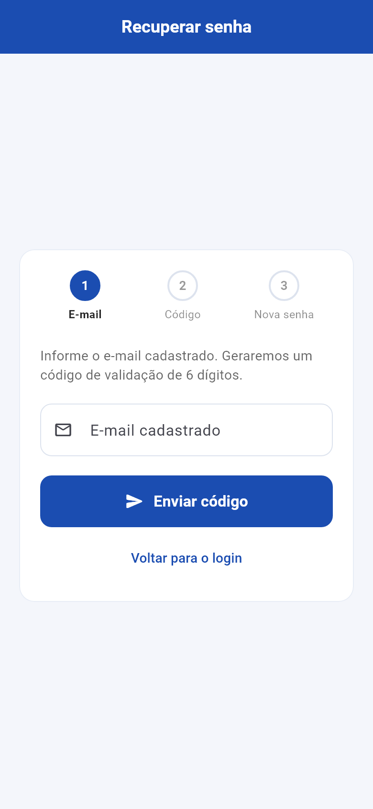 <br/> **Recuperação de senha** (RF03) | 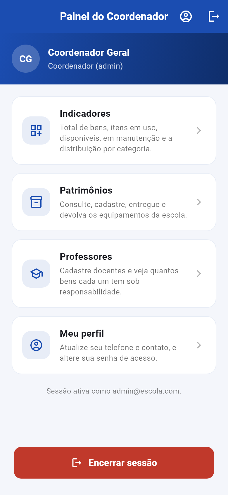 <br/> **Painel do Coordenador** |
| 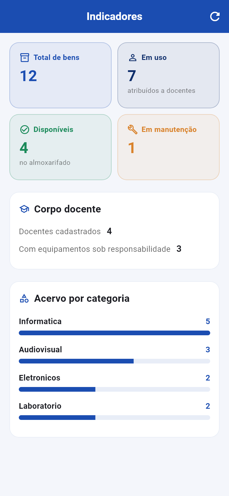 <br/> **Indicadores** (RF05) | 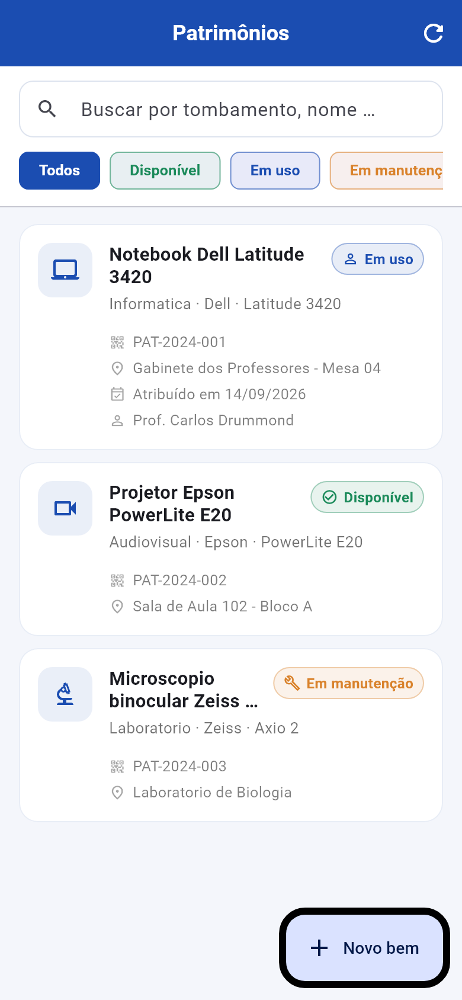 <br/> **Patrimônios** (RF07a) |
| 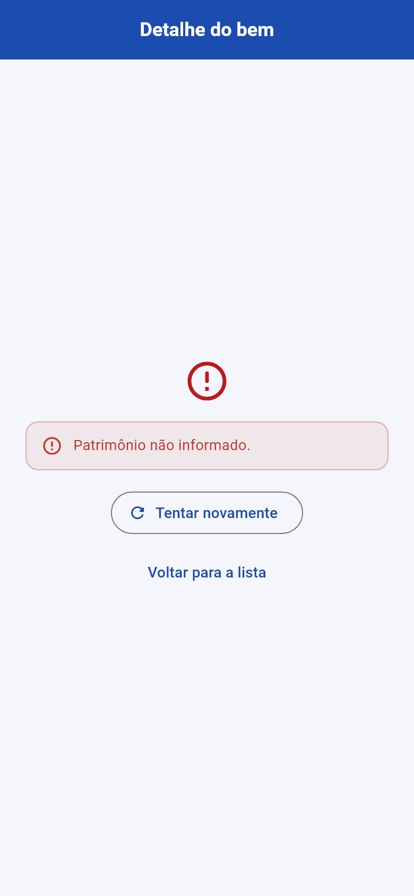 <br/> **Detalhe do bem** (RF07a) | 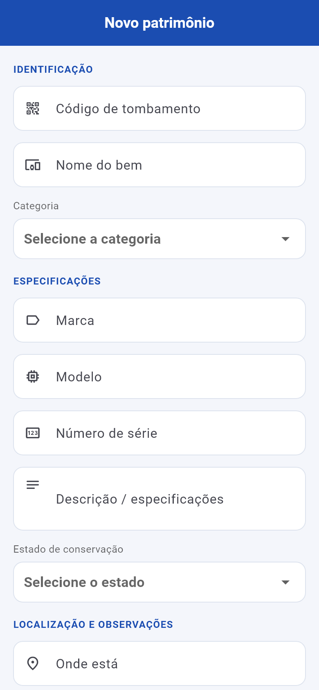 <br/> **Cadastro / edição** (RF07a) |
| 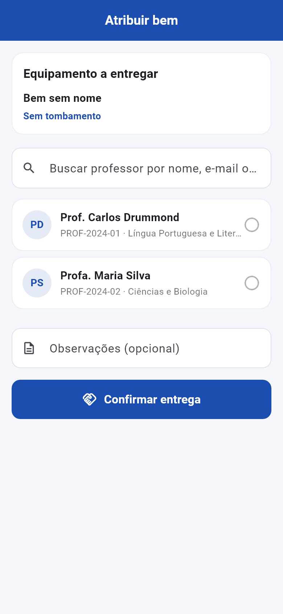 <br/> **Atribuição** (RF07b / RN05) | 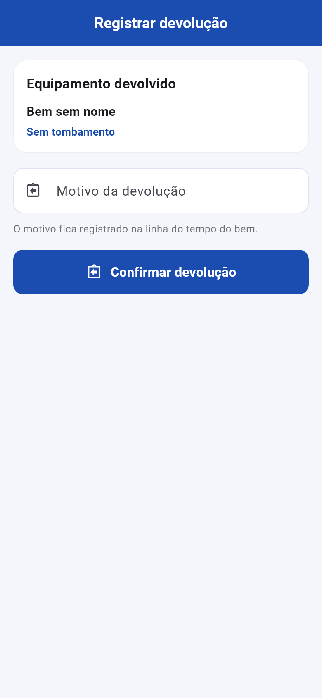 <br/> **Devolução** (RF07b / RN05) |
| 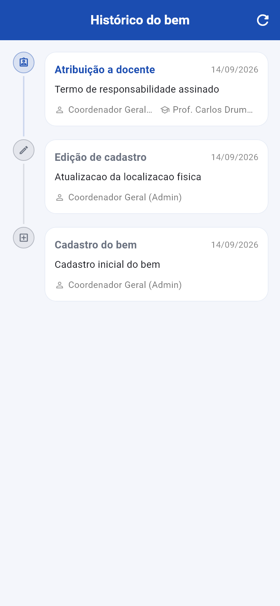 <br/> **Histórico** (RF07b) |  <br/> **Professores** (RF06) |
| 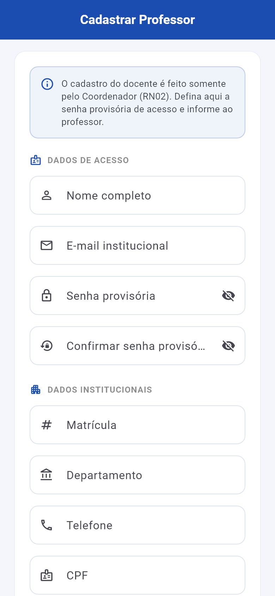 <br/> **Cadastro de professor** (RF06 / RN02) | 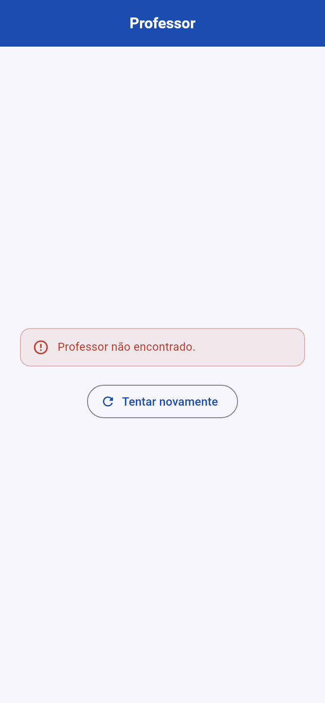 <br/> **Detalhe do professor** (RF06) |
| 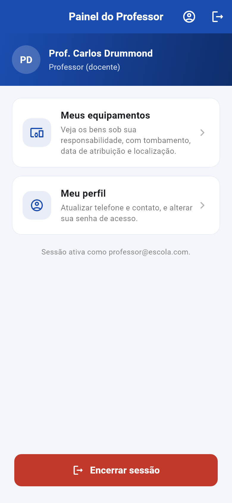 <br/> **Painel do Professor** | 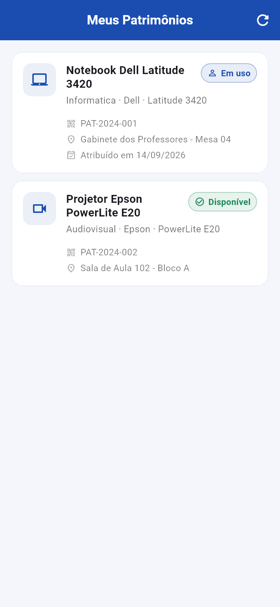 <br/> **Meus Patrimônios** (RF08) |
|  <br/> **Perfil** (RF09 / RN06) | |

---

## 📌 Status do Projeto

| Módulo | Requisitos | Situação |
|--------|-------------|----------|
| 1 — Autenticação e Sessão | RF01–RF04 | ✅ Concluído |
| 2 — Painel do Coordenador | RF05–RF07 | ✅ Concluído |
| 3 — Painel do Professor | RF08–RF09 | ✅ Concluído |

**Cobertura:** 9 de 9 requisitos funcionais e 7 de 7 regras de negócio
implementados. **317 testes automatizados** passando, com **80% de cobertura**
de linhas — o `dart_test.yaml` garante que a suíte rode um arquivo por
vez (o backend em Go tem uma corrida na tabela de refresh token que
falharia os testes de integração em paralelo).

| Requisito | Onde está |
|----------|-----------|
| RF01 Login, JWT seguro, rota por `role` | `views/auth/login_view.dart` · `controllers/auth_controller.dart` · `core/servicos/sessao_service.dart` |
| RF02 Cadastro de Coordenador (RN01) | `views/auth/cadastro_admin_view.dart` · `models/auth_requests.dart` |
| RF03 Recuperação de senha em 3 etapas | `views/auth/recuperar_senha_view.dart` |
| RF04 Logout seguro | `controllers/auth_controller.dart` · `widgets/dialogo_logout.dart` |
| RF05 Dashboard de indicadores | `views/admin/dashboard_view.dart` · `controllers/dashboard_controller.dart` · `models/patrimonio_stats_model.dart` |
| RF06 Gestão de professores (RN02) | `views/admin/professores/` · `controllers/professor_*_controller.dart` · `core/servicos/professor_service.dart` |
| RF07a Cadastro, busca, filtros, edição, exclusão | `views/patrimonio/` · `controllers/patrimonio_*_controller.dart` · `core/servicos/patrimonio_service.dart` |
| RF07b Atribuição e Devolução (RN05) | `views/patrimonio/patrimonio_atribuicao_view.dart` · `patrimonio_devolucao_view.dart` · `controllers/patrimonio_ciclo_vida_controller.dart` |
| RF07b Histórico / linha do tempo | `views/patrimonio/patrimonio_historico_view.dart` · `controllers/patrimonio_historico_controller.dart` · `models/historico_model.dart` |
| RF08 Meus Patrimônios (RN03) | `views/professor/meus_patrimonios_view.dart` · `controllers/meus_patrimonios_controller.dart` |
| RF09 Perfil: dados e senha (RN06) | `views/perfil/perfil_view.dart` · `controllers/perfil_controller.dart` · `core/servicos/perfil_service.dart` |

---

## 🧱 Arquitetura

Padrão **MVC** com gerenciamento de estado reativo via **GetX**.

```
lib/
├── main.dart                     Ponto de entrada e configuração do GetMaterialApp
│
├── app/                          Camada de configuração (não é View nem Model)
│   ├── bindings.dart             Injeção de dependências (Bindings do GetX)
│   ├── middleware.dart           Guardas de rota (RBAC) e regra de roteamento
│   ├── rotas.dart                Rotas nomeadas + transições
│   └── tema.dart                 Paleta, tipografia e estilos globais
│
├── core/                         infraestrutura transversal
│   ├── config/api_config.dart    URL base da API (detecta plataforma)
│   ├── servicos/
│   │   ├── api_client.dart       Cliente HTTP (Dio) + interceptors
│   │   ├── auth_service.dart     Endpoints de autenticação
│   │   ├── patrimonio_service.dart   Endpoints de patrimônio e ciclo de vida
│   │   ├── professor_service.dart    Endpoints de gestão de docentes
│   │   ├── perfil_service.dart       Endpoints de /profile
│   │   └── sessao_service.dart   Persistência segura do JWT (GetxService)
│   └── utils/
│       ├── api_erros.dart        Conversão de erro HTTP → AppException
│       ├── app_exception.dart    Exceção de negócio
│       ├── data_hora.dart        Formatação de datas
│       └── validadores.dart      Validações e máscaras reutilizáveis
│
├── models/                       Modelos de dados (JSON ↔ objeto)
│   ├── usuario_model.dart        Perfil do usuário + regras de RBAC
│   ├── auth_resposta.dart        Resposta de login
│   ├── auth_requests.dart        Corpos das requisições de autenticação
│   ├── professor_model.dart      Docente + bens vinculados
│   ├── professor_request.dart    Corpo do cadastro de docente
│   ├── perfil_request.dart       Corpos do PUT /profile
│   ├── patrimonio_model.dart     Bem do acervo
│   ├── patrimonio_criacao_model.dart  Resposta enxuta do POST
│   ├── patrimonio_stats_model.dart    Indicadores do dashboard (RF05)
│   ├── ciclo_vida_patrimonio_model.dart  Corpos de atribuir/devolver
│   ├── historico_model.dart      Linha do tempo do bem
│   └── status_patrimonio.dart    Enum de status + ações do histórico
│
├── controllers/                  Controller (regras de negócio da tela)
│   ├── splash_controller.dart
│   ├── auth_controller.dart
│   ├── dashboard_controller.dart            RF05
│   ├── patrimonio_controller.dart            RF07a — listagem
│   ├── patrimonio_detalhe_controller.dart    RF07a — detalhe
│   ├── patrimonio_form_controller.dart      RF07a — cadastro/edição
│   ├── patrimonio_ciclo_vida_controller.dart RF07b — atribuir/devolver
│   ├── patrimonio_historico_controller.dart  RF07b — linha do tempo
│   ├── professor_lista_controller.dart       RF06
│   ├── professor_cadastro_controller.dart    RF06
│   ├── professor_detalhe_controller.dart     RF06
│   ├── meus_patrimonios_controller.dart      RF08
│   ├── perfil_controller.dart                RF09
│
├── views/                        Views (apenas desenham)
│   ├── splash/splash_view.dart
│   ├── auth/                     login · cadastro_admin · recuperar_senha
│   ├── admin/                    admin_home · dashboard · professores/
│   ├── patrimonio/               lista · detalhe · form · atribuição · devolução · histórico
│   ├── professor/                professor_home · meus_patrimonios
│   └── perfil/perfil_view.dart
│
└── widgets/                      Widgets reutilizáveis (RNF04)
    ├── botao_primario.dart       Botão com estado de carregamento
    ├── campo_texto.dart          Input padronizado (senha, máscara, validação)
    ├── cabecalho_usuario.dart    Faixa de identificação do usuário
    ├── card_patrimonio.dart      Card de bem (usado em 3 telas)
    ├── cartao_professor.dart     Card de docente com contador de bens
    ├── cartao_indicador.dart     Card de indicador do dashboard
    ├── badge_status.dart         Etiqueta de status
    ├── estado_vazio.dart         Estado vazio (RNF02)
    ├── esqueleto_lista.dart       Skeleton de carregamento (RNF02)
    ├── linha_dado.dart           Linha rótulo/valor e título de seção
    ├── mensagem_erro.dart        Mensagens de erro, aviso e sucesso
    └── dialogo_logout.dart       Confirmação de saída

design/                           Protótipo de alta fidelidade
tool/gerar_prints_test.dart       Gerador dos prints do app
docs/prints/                      PNGs das telas
```

### Onde cada responsabilidade mora

| Camada | Pode fazer | Não pode fazer |
|--------|-----------|----------------|
| **Model** | Guardar dados, `fromJson`/`toJson`, getters de regra (`isAdmin`) | Falar HTTP, conhecer Flutter |
| **Controller** | Validar, orquestrar Service, expor estado reativo, navegar | Desenhar widgets, conhecer Dio |
| **View** | Desenhar, repassar toques, observar estado com `Obx` | Chamar a API, conter regra de negócio |
| **Service** | Falar HTTP e devolver Models | Importar `material.dart` |

---

## 🔐 Decisões técnicas

**1. Armazenamento seguro do token (RF01 / RNF03)**

O JWT **não** vai para `SharedPreferences`. É gravado em
`flutter_secure_storage`, que usa o `EncryptedSharedPreferences` no
Android, o Keychain no iOS/macOS e o DPAPI no Windows:

```dart
// core/servicos/sessao_service.dart
static const FlutterSecureStorage _storage = FlutterSecureStorage();
```

**2. Injeção automática do `Authorization` (RNF03)**

Um interceptor do Dio adiciona o cabeçalho em toda requisição, e outro
intercepta o `401` para renovar o token **uma única vez** e repetir a
requisição original — de forma transparente para quem chamou:

```dart
// core/servicos/api_client.dart
void _adicionarToken(RequestOptions options, RequestInterceptorHandler handler) {
  final token = _sessao.token.value;
  final ehPublica = options.extra['ignorarAuth'] == true;
  if (token.isNotEmpty && !ehPublica) {
    options.headers['Authorization'] = 'Bearer $token';
  }
  handler.next(options);
}
```

A trava `_renovando` evita que várias requisições expiradas ao mesmo
tempo gerem uma corrida de renovação. Quando o refresh token também
falha, a sessão é limpa e o app volta para o Login.

**3. Erros traduzidos em uma única fronteira**

Nenhum Controller conhece `DioException`. A função `chamar()` em
`core/utils/api_erros.dart` converte qualquer falha em `AppException`
com texto amigável, priorizando a mensagem que o próprio backend
enviou no formato `{"error": "..."}`:

```dart
Future<T> chamar<T>(Future<T> Function() acao) async {
  try {
    return await acao();
  } on AppException {
    rethrow;
  } on DioException catch (e) {
    throw AppException(mensagemDeErro(e), statusCode: e.response?.statusCode);
  } catch (e) {
    throw AppException('Ocorreu um erro inesperado. Tente novamente.');
  }
}
```

**4. Roteamento condicional por role (RBAC)**

A regra mora em um único lugar, `rotaPorSessao()`, usada tanto pela
Splash quanto pelo login e pelos middlewares:

```dart
String rotaPorSessao(SessaoService sessao) {
  final usuario = sessao.usuario.value;
  if (usuario != null && usuario.isAdmin) return Rotas.homeAdmin;
  return Rotas.homeProfessor;   // menor privilégio por padrão
}
```

Perfil desconhecido cai no painel do docente — a opção mais restrita.

**5. Defesas de interface (não substituem o backend)**

Três guardas de rota protegem a navegação:

| Guarda | Onde age | Regra |
|--------|----------|-------|
| `AutenticadoMiddleware` | telas internas | exige sessão válida |
| `AnonimoMiddleware` | Login, Cadastro, Recuperação | quem já está logado não volta para elas |
| `AdminMiddleware` | `/admin/...` | só o Coordenador (docente é devolvido ao próprio painel) |

A segurança real continua no servidor: um professor que tentar escrever
recebe **403 Forbidden** da API. Isso é coberto por um teste de
integração (`test/integracao_auth_test.dart`).

**6. FormKeys pertencem às Views**

Uma `GlobalKey<FormState>` guardada no Controller seria reutilizada por
duas instâncias da mesma tela durante uma transição de rota, e o
Flutter lançaria `Duplicate GlobalKey`. Por isso cada View cria a sua
própria key e passa o `FormState` ao Controller, que aplica as regras
de validação — e **também** as revalida, para que a tela não seja o
único guardião da regra:

```dart
// controllers/perfil_controller.dart
Future<void> salvarDados(FormState formulario) async {
  if (!formulario.validate()) return;

  final erroNome = validarNome(nomeCtrl.text);
  if (erroNome != null) { erro.value = erroNome; return; }
  ...
}
```

**7. Os campos de texto pertencem à tela, não ao Controller**

O `AuthController`, o `PerfilController` e os Controllers de formulário
guardam `TextEditingController` para que a regra de negócio fique em
um lugar só. Mas o GetX descarta o Controller **no instante em que a
rota é removida** — enquanto a View que usa aqueles campos ainda está
saindo da árvore (a transição leva 280 ms).

Ao ser desmontado, o `TextFormField` chama `removeListener` no
controller: se ele já estiver descartado, o Flutter estoura com

> A TextEditingController was used after being disposed.

e a tela fica coberta pelo erro vermelho. Era exatamente o que acontecia
ao sair do Login depois de entrar.

A solução está em `core/utils/text_controllers.dart`: o Controller
**limpa** os campos (para não deixar senha na memória) e **não** os
descarta — eles são liberados junto com o Controller, pelo coletor de
lixo. A varredura de telas (`test/varredura_telas_test.dart`) impede
que a regressão volte.

**8. A regra mora no Controller - e também no Form**

Toda validação é exposta pelo Controller (`validator:` nas Views) **e
reaplicada dentro do Controller**, antes da requisição:

```dart
Future<void> login(FormState formulario) async {
  if (!formulario.validate()) return;

  final erroEmail = validarEmailLogin(emailCtrl.text);
  if (erroEmail != null) { erro.value = erroEmail; return; }
  ...
}
```

O motivo é prático: se a View esquecer de ligar o `validator` em algum
campo, o dado inválido ainda não chega na API — e o login não gasta uma
requisição à toa. O mesmo vale para o código de recuperação de senha, a
senha nova e o cadastro do coordenador.

**9. Registro síncrono das dependências globais**

`Get.putAsync` só registra a instância **depois** que o Future resolve.
Usá-lo para a sessão e logo em seguida fazer `Get.find<SessaoService>()`
faz o `ApiClient` nunca ser registrado — e o login, que depende dele,
quebra em toda execução. O `MainBinding` por isso registra de forma
síncrona, e a leitura do armazenamento (assíncrona) fica a cargo do
`SplashController`, que é justamente a tela que decide o destino com
base na sessão salva.

**10. Um widget de patrimônio para as três telas (RNF04)**

O mesmo `CardPatrimonio` é usado na listagem do acervo, nos bens de um
docente e em "Meus Patrimônios". Ele é **estritamente informativo**:
nenhum botão de escrever mora no card, e quem tem ação de escrita
(Coordenador) coloca o botão na tela, fora dele. Assim o mesmo widget
serve ao docente sem precisar de uma variante "sem botões" (RN03).

---

## 🚀 Como Executar

### 1. Backend

```bash
# na raiz do projeto
./api.exe
```

A API sobe na porta **8081** e a documentação fica em
<http://localhost:8081/swagger/>.

> O `api.exe` acompanha o repositório para que ninguém precise instalar
> Go. O banco (`data.db`) **não** é versionado: ele é criado e
> alterado pelo servidor a cada execução.

#### Sobre o banco de dados e os custos

| Pergunta | Resposta |
|----------|----------|
| Precisa de servidor de banco de dados? | **Não.** O backend usa **SQLite**, um banco embutido em arquivo: sem servidor, sem instalação, sem senha, sem custo. |
| O app acessa o banco diretamente? | **Não.** O app fala HTTP com a API; só o backend toca o `data.db`. |
| O que o app guarda no celular? | Apenas o **JWT**, em `flutter_secure_storage` (criptografado), para não logar toda hora. Todo o domínio (bens, docentes, histórico) vive no backend. |
| Se o `data.db` for apagado? | Ele é recriado e populado automaticamente na próxima vez que `api.exe` rodar. Não há migração nem script de setup. |
| Custa alguma coisa? | **R$ 0.** Nenhum serviço pago, nenhuma chave de API, nenhuma conta em nuvem. O app funciona com a API rodando na mesma máquina (ou na rede local da escola). |

#### ⚠️ "Não foi possível conectar ao servidor"

O erro mais comum de desenvolvimento com este projeto. Ele significa que
o app **não conseguiu abrir conexão** com a API.

> **Cada pessoa precisa do `api.exe` rodando na própria máquina.** O
> backend é um servidor local — não está "na nuvem" e não é
> compartilhado. Rode `./api.exe` **antes** de rodar o app.

A tela de Login tem um botão **"Verificar conexão com a API"** que faz
o diagnóstico na hora: mostra **qual endereço** o app está usando, se a
API respondeu e o que fazer.

| Onde o app roda | Endereço | Por quê |
|------------------|----------|---------|
| Emulador Android (oficial) | `http://10.0.2.2:8081/api` | `10.0.2.2` é o alias da máquina, visto de dentro do emulador |
| Simulador iOS / desktop / Chrome | `http://localhost:8081/api` | app e backend na mesma máquina |
| Celular físico (Wi-Fi) | `http://192.168.x.x:8081/api` | o IP da máquina na rede local |

Checklist rápido (detalhes no [guia](docs/GUIA.md)):

1. O `api.exe` está rodando? Se a janela do console **some na hora**,
   o Windows bloqueou o executável: clique com o botão direito →
   **Propriedades** → **Desbloquear**.
2. A porta 8081 está livre? `netstat -ano | findstr :8081`.
3. No celular físico: mesmo Wi-Fi e `api.exe` liberado no firewall.
4. Emulador Android em máquina virtual (Genymotion/WSA): o `10.0.2.2`
   pode não existir — use `--dart-define=API_BASE_URL=http://<ip>:8081/api`.

#### CPF e telefone: podem ser qualquer valor

O app **não** confere o dígito verificador do CPF e **não** consulta
nenhuma base de telefone. São dados de identificação, não dados
fiscais — e o backend também não valida (testado: ele grava
`123.456.789-45` sem reclamar).

| Campo | Aceito | Motivo |
|-------|--------|--------|
| **CPF** | Qualquer sequência de **11 dígitos** (a máscara `000.000.000-00` é aplicada) | A escola cadastra professor convidado, servidor terceirizado e docente de outra instituição — todos sem CPF próprio. |
| **Telefone** | De **8 a 15 dígitos** (fixo, celular ou E.164 internacional) | O app não tem como saber se o número existe. |

**Para testar, digite qualquer coisa.** O que protege o patrimônio é o
token de sessão, não o número do documento. A regra vive em
`lib/core/utils/validadores.dart` e vale para os três formulários
(Coordenador, Professor e Perfil).

### 2. App

```bash
flutter pub get
flutter run
```

### 2.1 Device Preview — emular o celular no Chrome

Para conferir o comportamento responsivo (RNF01) sem trocar de
emulador, o app tem um ponto de entrada de desenvolvimento que o
envelopa no `device_preview`:

```bash
# abre direto no Chrome, com o app dentro da moldura de um celular
flutter run -d chrome -t dev/main_dev.dart
```

Outras opções úteis:

```bash
# emulador Android / iOS físico, já com a moldura do aparelho
flutter run -t dev/main_dev.dart

# só servir (útil para testar no celular na mesma rede)
flutter run -d web-server -t dev/main_dev.dart
```

A barra lateral do DevicePreview permite trocar de aparelho, girar a
tela, alternar o dark mode, ajustar o tamanho do texto e ligar o teclado
virtual.

| Situação | Device |
|----------|--------|
| Checar overflow em tela pequena | `Devices.ios.iPhoneSE` · `Devices.android.smallPhone` |
| Base do design | `Devices.ios.iPhone13` (padrão) |
| Tela grande | `Devices.ios.iPhone16ProMax` |
| Tablet | `Devices.ios.iPad` · `Devices.android.mediumTablet` |

**No Chrome, a API é acessada em `http://localhost:8081/api`.** A API em
Go já responde com `Access-Control-Allow-Origin: *`, então o navegador
consegue chamar o backend normalmente — o login funciona direto no
Chrome, sem configuração extra.

### 3. Endereço da API

`core/config/api_config.dart` escolhe o endereço automaticamente:

| Ambiente | URL |
|----------|-----|
| Emulador Android | `http://10.0.2.2:8081/api` |
| Simulador iOS / desktop | `http://localhost:8081/api` |
| Celular físico (Wi-Fi) | `http://192.168.x.x:8081/api` |

Para apontar manualmente, sem alterar o código:

```bash
flutter run --dart-define=API_BASE_URL=http://192.168.0.10:8081/api
```

> **No iOS e no macOS**, a API de desenvolvimento responde em HTTP sem
> TLS. O projeto já traz a exceção do App Transport Security
> (`NSAllowsLocalNetworking`) em `ios/Runner/Info.plist` e
> `macos/Runner/Info.plist` — ela libera **apenas** a rede local, sem
> desligar a segurança para a internet.
>
> **No Android**, a permissão `INTERNET` está no manifest principal
> (`android/app/src/main/AndroidManifest.xml`). Sem ela, o APK de
> *release* não consegue abrir nenhuma conexão.

### 4. Testes

```bash
flutter analyze          # análise estática
flutter test             # suíte completa (280 testes)
```

A suíte é dividida em quinze arquivos:

| Arquivo | Escopo | Precisa do backend? |
|---------|--------|---------------------|
| `test/widget_test.dart` | Regras de RBAC, estado da sessão, widgets | Não |
| `test/bindings_test.dart` | Grafo de dependências do `MainBinding` e guardas de rota | Não |
| `test/device_preview_test.dart` | DevicePreview aplica o tamanho real do aparelho | Não |
| `test/fluxo_rotas_test.dart` | Navegação, guards, validação e restauração de sessão | Não |
| `test/varredura_telas_test.dart` | **Varredura de todas as 17 telas** em 3 tamanhos — nenhuma pode estourar layout nem disparar exceção | Não |
| `test/patrimonio_test.dart` | Models, Services e widgets do acervo | Não |
| `test/patrimonio_controller_test.dart` | Listagem, busca com debounce e filtros | Não |
| `test/patrimonio_lista_view_test.dart` | Tela de listagem, estados assíncronos, overflow | Não |
| `test/patrimonio_form_view_test.dart` | Formulário em modo cadastro e edição | Não |
| `test/ciclo_vida_patrimonio_test.dart` | RF05, RF07b e RF08 (dashboard, atribuição, devolução, histórico) | Não |
| `test/professores_test.dart` | RF06 e RBAC das telas de professores | Não |
| `test/perfil_test.dart` | RF09 / RN06 | Não |
| `test/campo_texto_senha_test.dart` | Botão de mostrar/ocultar senha, no widget e nas telas reais | Não |
| `test/diagnostico_conexao_test.dart` | Diagnóstico de conexão com a API (tela de Login) | Não |
| `test/integracao_auth_test.dart` | Login, cadastro, recuperação e 403 do docente | Sim (ignorados se a API estiver fora) |
| `test/integracao_patrimonio_test.dart` | Listagem, filtros e ciclo completo contra a API | Sim (ignorados se a API estiver fora) |
| `test/integracao_diagnostico_test.dart` | Diagnóstico contra a API real (ligada e desligada) | Sim (ignorado se a API estiver fora) |

> **Detalhe importante:** dentro de `testWidgets` o tempo é *fake*, então
> chamadas reais de plataforma (o `flutter_secure_storage`) nunca
> completam e travam o teste. Por isso existe um dublê do armazenamento
> seguro em `test/helpers/test_armazenamento.dart`. Com ele, o ciclo
> "gravar sessão → reabrir o app → restaurar sessão" é testado de ponta
> a ponta, pelo mesmo caminho usado pelo app real.

> **Concorrência:** o `dart_test.yaml` define `concurrency: 1`. Dois
> arquivos de teste de integração batem na API real ao mesmo tempo e o
> backend em Go tem uma corrida na tabela de refresh token
> (`Erro ao salvar sessão de refresh token`). Rodando um arquivo por
> vez, a suíte inteira passa.

### 5. Gerar os prints

```bash
flutter test tool/gerar_prints_test.dart
```

Monta as 17 telas com as widgets reais e grava os PNGs em
`docs/prints/`. É o mesmo mecanismo que produz as imagens deste
README.

### 6. ⚠️ Caminho com espaço no Windows

Se o caminho do projeto (ou do perfil do Windows) tiver **espaço**, o
`flutter test` falha com `Building native assets for package:objective_c
failed`. A causa é o hook de native assets do pacote `objective_c`
(dependência transitiva do `flutter_secure_storage` para macOS), que
invoca o `dart` com o caminho sem aspas.

Duas saídas:

```bash
# 1. apontar o PUB_CACHE para um caminho sem espaços
set PUB_CACHE=C:\pubcache
flutter pub get
flutter test

# 2. (recomendado) clonar o projeto em um caminho sem espaços
#    C:\dev\reserva-mobile
```

### 7. Integração contínua

`.github/workflows/ci.yml` roda `flutter analyze --fatal-infos` e
`flutter test` em cada Pull Request para a `main`. O badge fica no
topo deste README.

---

## 🎨 Protótipo de alta fidelidade

O protótipo visual está em [`design/prototipo.html`](design/prototipo.html):
um arquivo HTML autocontido com as **17 telas** do app desenhadas na
grade de 390 × 844 do iPhone 13, com a mesma paleta e a mesma
tipografia do Flutter.

Para levar para o Figma (gratuito):

1. Sirva a pasta do projeto (`npx serve .` ou `python -m http.server`);
2. No Figma, use o plugin **HTML to Design** apontando para
   `design/prototipo.html`;
3. Cada frame vira um artboard de 390 × 844.

O documento [`design/PROTOTIPO.md`](design/PROTOTIPO.md) traz o
inventário de telas, os tokens de design e o passo a passo.

---

## 👥 Equipe

A tabela abaixo reflete o histórico real do repositório: cada linha
pode ser conferida em `git log --author="<nome>"` e nos Pull Requests
citados.

| Membro | Responsabilidade | Parte | Evidência no histórico |
|--------|------------------|-------|--------------------------|
| **Guilherme Ballestrim Sobreira** | Estrutura base do projeto e camada de dados: Models (`auth_resposta`, `patrimonio_model`, `professor_request`), bring-up do `api.exe` e convenção de branches | 1 | PR #1 — `model` |
| **Matheus Lima Catarucci** | **Autenticação e Sessão (RF01–RF04)**: login, cadastro de Coordenador, recuperação de senha em 3 etapas, armazenamento seguro do JWT, interceptors de token, Device Preview e CI | 2 | PR #2 — `parte-2-autenticacao` |
| **joaovacosta** | **Gestão de Professores (RF06)** e **Perfil (RF09)**: telas de listagem, cadastro e detalhe do docente, tela de perfil, `AdminMiddleware` e widgets de professor/dado | 4 e 5 | PRs de `Profs-e-Perfil` |
| **Gabriel** | **Gestão de Patrimônios (RF07)**: Models, `PatrimonioService`, listagem com busca e filtros, detalhe, formulário, badges e cards. E a **consolidação final**: dashboard de indicadores (RF05), ciclo de vida do bem — atribuição, devolução e linha do tempo (RF07b/RN05) —, "Meus Patrimônios" (RF08), correção de rotas, plataforma (INTERNET/ATS) e documentação | 3, 4 e 5 | PRs #3–#9 e `feature/modulos-2-e-3` |
| **MoisesTafarello** | **Administração Geral (Parte 6)**: tela de usuários do sistema, alteração de papel (`admin` ↔ `professor`) e métricas de sessão. Em andamento na branch `feature/administracao-geral`. | 6 | Branch `feature/administracao-geral` (plano em [`docs/partes/`](docs/partes/)) |

### Divisão dos módulos por tela e controller

| Parte | Telas | Controllers |
|-------|-------|-------------|
| 1 — Base | `splash` | `splash_controller` |
| 2 — Autenticação | `login` · `cadastro_admin` · `recuperar_senha` | `auth_controller` |
| 3 — Dados e widgets | — (Services e Models) | `api_client` · `sessao_service` · `auth_service` |
| 4 — Coordenador | `admin_home` · `dashboard` · `professores/*` · `patrimonio/*` | `dashboard_controller` · `professor_*_controller` · `patrimonio_controller` · `patrimonio_detalhe_controller` · `patrimonio_form_controller` · `patrimonio_ciclo_vida_controller` · `patrimonio_historico_controller` |
| 5 — Professor | `professor_home` · `meus_patrimonios` · `perfil` | `meus_patrimonios_controller` · `perfil_controller` |
| 6 — Administração Geral | `usuarios/*` (em andamento) | `admin_usuarios_controller` |

O plano de cada parte, com o passo a passo e os critérios de
aceitação, fica em [`docs/partes/`](docs/partes/).

> **Antes da arguição:** o §9 do enunciado exige que **todos** os
> integrantes tenham domínio do código entregue. Cada linha desta
> tabela corresponde a commits reais — use
> `git log --author="<nome>" --stat` para revisar o que cada um
> escreveu, e `git show <commit>` para revisar o código em si.

---

## 📄 Licença

Projeto acadêmico. O backend (`api.exe`) é fornecido pela equipe de
backend da instituição.
